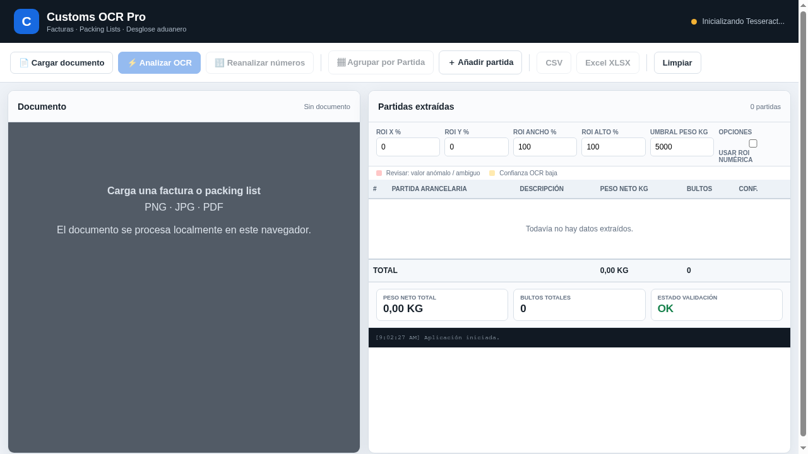
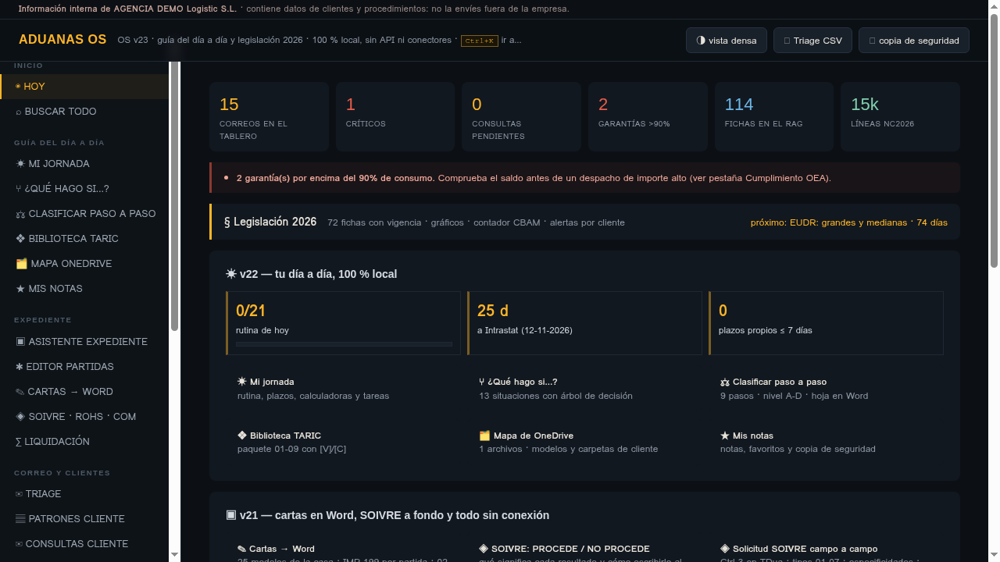
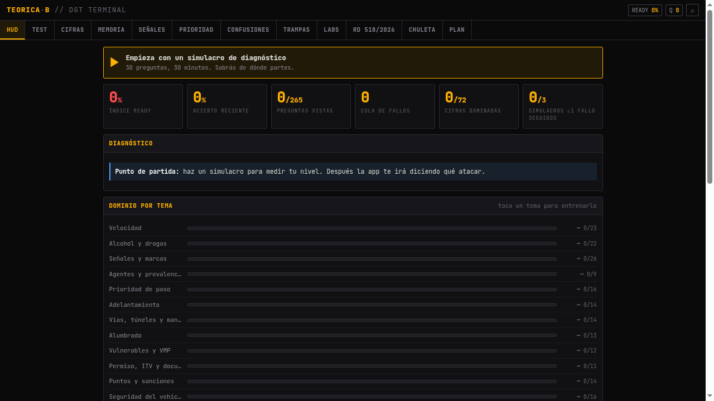

# AI Apps Portfolio

**English** | [Español](#espanol)

Three single-file web apps I built with AI assistance. Each one is a self-contained `.html` file - no server, no install: open it in a browser and it works. All data inside is synthetic demo data.

## Live demos

| App | What it is | Demo |
|-----|-----------|------|
| **Customs OCR Pro** | Reads supplier invoices and packing lists (photo or scan) and extracts line items ready for customs processing. | [Open demo](https://andrescampomar2010-dotcom.github.io/ai-apps-portfolio/customs-ocr-pro.html) |
| **ADUANAS OS** | Interactive training simulator for customs-agency work: DUA declarations, TARIC classification, transit, deposits, with guided exercises. | [Open demo](https://andrescampomar2010-dotcom.github.io/ai-apps-portfolio/aduanas-os.html) |
| **TEORICA·B** | Driving-theory trainer for the Spanish DGT B licence: question bank, exam mode and review of failures. | [Open demo](https://andrescampomar2010-dotcom.github.io/ai-apps-portfolio/teorica-b-dgt.html) |

## Screenshots

## Why single-file apps

I build tools this way so anyone can run them without setup: one file, works offline, easy to share. For a larger project with the same approach, see [customs-clearance-processor](https://github.com/andrescampomar2010-dotcom/customs-clearance-processor).

Everything here is demo material: no real company, client or shipment data.

---

# Portfolio de apps con IA

Tres aplicaciones web de un solo archivo, construidas con ayuda de IA. Cada una es un `.html` autocontenido: sin servidor, sin instalación, se abre en el navegador y funciona. Todos los datos son sintéticos de demostración.

## Demos en vivo

| App | Qué es | Demo |
|-----|--------|------|
| **Customs OCR Pro** | Lee facturas y packing lists de proveedores (foto o escaneo) y extrae las líneas listas para el despacho. | [Abrir demo](https://andrescampomar2010-dotcom.github.io/ai-apps-portfolio/customs-ocr-pro.html) |
| **ADUANAS OS** | Simulador interactivo para aprender el trabajo de una agencia de aduanas: DUA, clasificación TARIC, tránsitos, depósitos, con ejercicios guiados. | [Abrir demo](https://andrescampomar2010-dotcom.github.io/ai-apps-portfolio/aduanas-os.html) |
| **TEORICA·B** | Entrenador de teórica para el permiso B de la DGT: banco de preguntas, modo examen y repaso de fallos. | [Abrir demo](https://andrescampomar2010-dotcom.github.io/ai-apps-portfolio/teorica-b-dgt.html) |

## Por qué apps de un solo archivo

Construyo así para que cualquiera pueda usarlas sin instalar nada: un archivo, funciona sin conexión y se comparte fácil. Para un proyecto mayor con el mismo enfoque, ver [customs-clearance-processor](https://github.com/andrescampomar2010-dotcom/customs-clearance-processor).

Todo el contenido es material de demostración: sin datos de empresas, clientes ni envíos reales.
